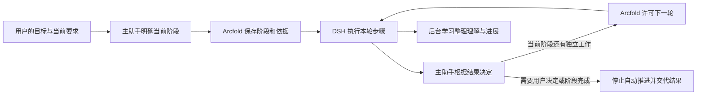

# Arcfold 目标推进与 DSH 执行

## 当前改造合同

用户授权 Arcfold 判断当前推进哪一部分、继续或等待；DSH 承担这一具体委托的实际执行。保留唯一官方 `goal-round-driver`，Arcfold 不创建第二个调度器。主助手作内容判断，代码落实阶段身份、来源、版本与单轮许可；后台学习不写执行许可。

控制工具（同一主助手，无新增监督模型）：

- `arcfold_start_work`：当前真实用户已委托持续工作时建立一个具体阶段；输入 `objective`、`doneWhen`、`boundaries`、可选 `max_goal_rounds`。这些分别为眼前任务、可检查的完成条件和范围/需等待的条件。只讨论长期目标无需启动执行。
- `arcfold_revise_work`：在新的真实用户要求下修改当前阶段，另带 `goal_id`、`revision`；旧继续许可失效。
- `arcfold_decide_work`：本轮工作后单独调用，输入 `goal_id`、`revision`、`action`（`continue/wait/complete`）、`reason`、`stageDone`、`needsUserDecision`、`nextStep`。只有阶段未完成且无需用户决定、下一步明确时，才可发下一轮许可；提交决定后本轮只交代结果。
- `arcfold_resume_work`：沿用新用户原话与版本核验，经过 Arcfold 恢复既有阶段。旧版没有阶段的执行记录须先明确阶段，不能直接恢复。
- `get_goal`：只读当前 DSH 执行状态及 Arcfold 阶段。

状态保存使用 `execution_stages` 与不可改写的 `stage_decisions`。阶段绑定真实原话、原生工作 id/revision、定义及控制代次；每次继续许可只匹配下一轮编号，开始前消费。一般存储版本变化不等于定义变化。

程序检查位置：原生控制变更后、下一轮进入前、最终模型发送前、工具执行前、本轮正式结束前。没有明确继续决定时停下；任何新用户输入使旧的未消费许可失效。等待、完成、暂停、修改与原生绕过控制均不能复用旧许可。

原生 `tool-goal` 和 `command-goal` 从主预设撤下，保留拒绝旧变更工具的检查。原生网页/API 仍能提交控制事件，但未经 Arcfold 控制入口签发的创建、修改或恢复会立即取消激活；停止动作始终允许。冷启动保留 DSH 默认不自动激活的行为。旧历史与未知请求不重写、不重放。

长期目标关系属于背景理解，阶段许可属于执行控制，两者分别保存。实际交付与长期目标收益分别记录；字段与测试通过不证明语义判断或长期价值。

## 验证与发布

先运行真实 DSH 宿主加本机固定响应的测试，覆盖继续一次、等待、完成、默认停止、并发输入、原生控制绕过、暂停/修改/恢复、重启及旧记录兼容。再以独立预算账本进行最多人民币5元的 DeepSeek 真实验证；未知请求保留最坏预留。网页配置与费用独立。

源码接受与发布经 `arcfold-dev`；保留用户配置、数据、历史和未知费用。实际完成记录将在候选验证后补充，本文件当前描述实现合同。
